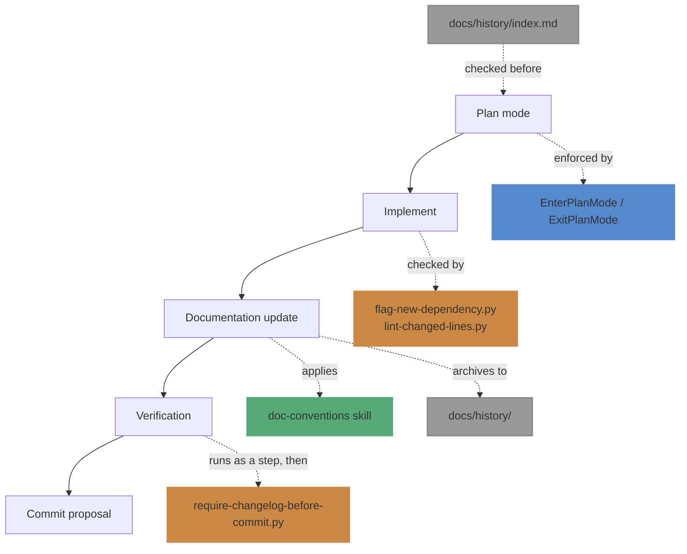

# Agents overview

This repo turns two prose files (`instructions.md`, `CLAUDE.md`) into an actual Claude Code harness:
native permission modes, skills, subagents, and hooks doing the enforcement that prose can only ask for.
This page is the map; the other numbered docs go deep on one piece each.

## Why this exists

Prose instructions have two failure modes: the model has to remember to follow them, and every repo that
wants the same behavior needs its own copy. This harness addresses both:

- **Reliability** comes from moving rules to the mechanism that actually enforces them — a permission
  boundary (plan mode) instead of a verbal convention, a hook instead of a rule the model has to recall, a
  skill that loads its full content only when relevant instead of competing for attention the whole
  session.
- **No duplication** comes from [cross-repo distribution](03-cross-repo-distribution.md): one copy of each
  skill, subagent, and hook script lives in this repo, and every other repo reaches it through a symlink
  or a global config entry — never a copy.

## The pieces, and how a wave uses them

Blue is a permission boundary, orange is a hook, green is a skill, gray is a plain file check with no
mechanism enforcing it yet (see below) — see the [glossary](glossary.md) if those terms are new. Each wave
phase is backed by a different kind of mechanism, chosen for how reliably that phase's rule needs to hold:

| Phase | Mechanism | Why this one |
|---|---|---|
| Plan | Plan mode, after checking `docs/history/index.md` | Needs to be a hard permission boundary — the whole point is that discussion can go on indefinitely before anything is touched, without relying on the model remembering not to edit yet. The history check is prose-level (no hook fires on "should I check history first"), but happens before the boundary is entered so it can shape the plan. |
| Implement | Hooks (`flag-new-dependency`, `lint-changed-lines`) | Fully mechanical checks (is this a new dependency? does this line lint?) that should fire every time, not just when remembered. |
| Documentation update | `doc-conventions` skill, applied via a forked agent, plus archiving the concluded session plan to `docs/history/` | Needs the full conversation's context of what was just built, so a fork; the conventions themselves live in a skill so they load in full only when a `.md` file is actually being touched. Archiving reuses the same pass since it's the same "wrap up what this wave produced" work. |
| Verification | A step (main agent runs tests directly), plus a hook for changelog ordering | Judgment (is this failure pre-existing or new?) can't be a hook, so it stays a step; the changelog-before-commit check is pure mechanics, so that part is a hook. |
| Commit proposal | Normal chat proposal | No new mechanism needed — drafting a message and waiting for confirmation is already reliable as prose. |

`docs/history/` and its use in Plan/Documentation update are prose-level (no hook enforces either side yet)
— see `instructions.md`'s *Plan history* section for the convention and its known reliability gap (nothing
catches a plan abandoned without the agent remembering to archive it).

The `wave` skill ([`02-skills-and-subagents.md`](02-skills-and-subagents.md)) is what actually drives an
agent through these five phases end-to-end, but every mechanism above also works standalone — a hook fires
whether or not `wave` is the thing that triggered the edit it's checking.

## Reading further

- [`01-hooks.md`](01-hooks.md) — every hook, what event triggers it, what it checks, and how to test it
  standalone.
- [`02-skills-and-subagents.md`](02-skills-and-subagents.md) — `wave`, `doc-conventions`, `doc-sweep`,
  `sdk-release`.
- [`03-cross-repo-distribution.md`](03-cross-repo-distribution.md) — how the symlink setup works, and the
  monorepo gotcha it ran into.
- [`glossary.md`](glossary.md) — terms used across all of these.
