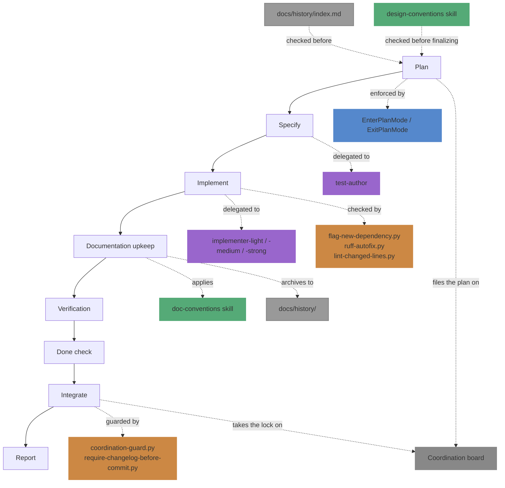

# Agents overview

This repo turns two prose files (`instructions.md`, `CLAUDE.md`) into an actual Claude Code harness:
native permission modes, skills, subagents, and hooks doing the enforcement that prose can only ask for.
This page is the map; the other numbered docs go deep on one piece each.

## Why this exists

Prose instructions have two failure modes: the model has to remember to follow them, and every repo that
wants the same behavior needs its own copy. This harness addresses both:

- **Reliability** comes from moving rules to the mechanism that actually enforces them: a permission
  boundary (plan mode) instead of a verbal convention, a hook instead of a rule the model has to recall, a
  skill that loads its full content only when relevant instead of competing for attention the whole
  session.
- **No duplication** comes from [cross-repo distribution](03-cross-repo-distribution.md): one copy of each
  skill, subagent, and hook script lives in this repo, and every other repo reaches it through a symlink
  or a global config entry — never a copy.

## The pieces, and how a wave uses them

A wave runs in its own worktree and passes through eight phases. The plan is written with you in plan mode;
everything after approval runs without asking, and the done check replaces any approval of the result.

Blue is a permission boundary, orange is a hook, green is a skill, purple is a subagent, gray is the board
or a plain file check with no mechanism enforcing it yet. See the [glossary](glossary.md) if those terms
are new. Each phase is backed by the kind of mechanism its rule needs:

| Phase | Mechanism | Why this one |
|---|---|---|
| Plan | Plan mode, after checking `docs/history/index.md` and the `design-conventions` skill | A hard permission boundary, so the concrete plan can be revised before anything is touched. The plan carries acceptance cases, a sub-task table with a tier per row, and board fields. Both checks are prose-level and happen before the boundary is entered so they can shape the plan. On approval the plan is filed on the [coordination board](05-parallel-waves.md). |
| Specify | `test-author` subagent | The tests that define "done" are written by an agent that does not write the code, so a test cannot be bent to fit an implementation. Their commit is the tests-first commit; from then on the tests are frozen. |
| Implement | `implementer-light`, `-medium`, `-strong`, plus hooks (`flag-new-dependency`, `ruff-autofix`, `lint-changed-lines`) | Scoped execution runs on the cheapest tier that can do it well; the wave agent keeps the judgment and reviews each diff. The hooks are mechanical checks that fire on every edit. |
| Documentation upkeep | `doc-conventions` skill, applied by the wave agent and its implementers, plus archiving the session plan to `docs/history/` | Scoped to what the wave made wrong. A documentation sweep is its own wave (`doc-sweep`), never part of another wave. |
| Verification | A step: the wave agent runs the tests itself | Judging whether a failure is pre-existing or new needs the Implement context, so it is not a hook or a subagent. |
| Done check | A table in the `wave` skill: every row needs its evidence | The one gate before integration. It replaces an approval of the commit. |
| Integrate | `board.py` integration lock, `coordination-guard.py` | Integration is serial per repo and respects holds; the guard blocks a push or PR completion while another wave holds the lock or a merge hold is open. |
| Report | The report format in the `wave` skill | One fixed report per wave, which becomes the pull request description. |

`docs/history/` and its use in Plan and Documentation upkeep are prose-level: no hook enforces either side.
See `instructions.md`'s *Plan history* section for the convention and its known reliability gap (nothing
catches a plan abandoned without the agent remembering to archive it).

## Who runs a wave

| Piece | Role |
|---|---|
| Planning chat | You and an agent in plan mode. Each approved plan is filed on the board as `ready`. "Run wave N interactively" keeps that wave in the same session instead. |
| Coordinator | One long-lived session (`/coordinate`, started in `~/Projects`). It starts `ready` waves as background wave runners, at most four at once, relays their questions to you and wakes parked waves. |
| `wave-runner` | The wave agent of one batch wave, running the `wave` skill from Specify to Report in the wave's worktree. |
| Coordination board | The files under `~/.claude/coordination/` that hold plans, holds, locks, requests and notices, managed through `board.py`. |

The `wave` skill ([`02-skills-and-subagents.md`](02-skills-and-subagents.md)) drives an agent through the
phases, and every mechanism above also works standalone: a hook fires whether or not `wave` triggered the
edit it is checking. The board, holds, parking and the coordinator are described in
[`05-parallel-waves.md`](05-parallel-waves.md).

## Reading further

- [`01-hooks.md`](01-hooks.md): every hook, what event triggers it, what it checks, and how to test it
  standalone.
- [`02-skills-and-subagents.md`](02-skills-and-subagents.md): `wave`, `coordinate`,
  `implementer-contract`, the implementer tiers, `test-author`, `wave-runner`, `doc-sweep`,
  `deck-visual-check`, `doc-conventions`, `design-conventions`, `ruff-cleanup`, `sdk-release`,
  `langfuse-upgrade`, the `semeval-*` skills.
- [`03-cross-repo-distribution.md`](03-cross-repo-distribution.md): how the symlink setup works, and the
  gotchas it ran into.
- [`04-working-with-the-harness.md`](04-working-with-the-harness.md): the experience of using this day
  to day: the planning chat, the coordinator chat, how skills activate, and what it standardizes across a
  team.
- [`05-parallel-waves.md`](05-parallel-waves.md): the coordination board, wave lifecycle, holds, parking,
  the coordinator and integration.
- [`glossary.md`](glossary.md): terms used across all of these.
