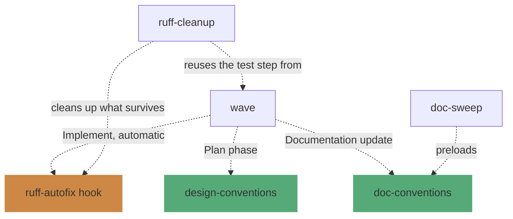

# Working with the harness

[`00-agents-overview.md`](00-agents-overview.md) covers the mechanism: how a wave uses plan mode, hooks,
and skills together. This page covers the experience: what it's actually like to work with this harness
session to session, and what it standardizes once it's in place.

## Interactive, not autonomous

A session is a conversation with an agent, not a pipeline running unattended. Plan mode is a genuine
back-and-forth — discuss, revise, discuss again, for as many turns as it takes — and nothing gets touched
until you approve. Only the *approved* plan gets implemented, and even then Verification and Commit
proposal are further checkpoints, not a rubber stamp on the way to a foregone conclusion.

```mermaid
graph TD
  subgraph Human["Human"]
    H1["Discuss and revise the plan"]
    H2["Approve the plan"]
    H3["Review and confirm the commit"]
  end

  subgraph Agent["Agent"]
    A1["Explore and propose an approach"]
    A2["Implement only what was approved"]
    A3["Run verification, report results"]
    A4["Draft the commit message"]
  end

  H1 <-->|"plan mode: as many rounds as needed"| A1
  H1 --> H2
  H2 -->|"exits plan mode"| A2
  A2 --> A3
  A3 --> A4
  A4 --> H3

  style Human fill:#1a3a1a,stroke:#55aa77,stroke-width:2px
  style Agent fill:#1a2a3a,stroke:#5588cc,stroke-width:2px
```

The agent never runs unsupervised past what was actually approved — it doesn't wander into adjacent
"improvements," and it doesn't skip the review at the end because the plan looked straightforward going
in.

## Two ways a skill activates

A skill's content isn't loaded by default — it only enters context when triggered. These are two
independent entry points, not a choice the agent makes between them — they just happen to land the same
content:

```mermaid
graph TD
  E["Explicit: you type a slash command,<br/>or the agent calls Skill by name"] --> L["Skill content loads fresh"]
  I["Inferred: your message happens<br/>to match a skill's description"] --> L
  L --> W["Agent applies it this turn"]

  style E fill:#1a2a3a,stroke:#5588cc,stroke-width:2px
  style I fill:#1a2a3a,stroke:#5588cc,stroke-width:2px
  style L fill:#55aa77,stroke:#55aa77,stroke-width:2px
```

- **Explicit** — you type `/wave`, `/ruff-cleanup`, or the agent calls the Skill tool directly by name.
- **Inferred** — the agent recognizes your message matches a skill's `description` and loads it without
  being asked by name.

Neither path is "more official" than the other — both land the same content. What matters more the
longer a session runs is *re-invoking* a skill at the moment its content is actually needed, rather than
working from a memory of having read it earlier in the conversation — see `CLAUDE.md`'s "Skill freshness"
note for why.

## Putting it together: a typical project lifecycle

None of the pieces above run in a fixed sequence — they're tools you dip into as needed, in either
order, moving between them by typing `/name` or just saying what you want next. A realistic stretch of
work tends to look like this, looping and branching rather than running straight through once:

```mermaid
graph TD
  Disc["Ongoing discussion<br/>no formal structure"] --> BL["Add to backlog<br/>Next Up / Planned / Later Considerations"]
  BL --> Disc
  BL --> Plan["Plan a wave<br/>design-conventions checked fresh"]
  Plan --> Run["Implement, document, verify"]
  Run --> Commit["Commit this wave"]
  Commit --> Plan
  Commit --> Cleanup["ruff-cleanup<br/>once, before opening or updating the PR"]
  Cleanup --> Commit
  Cleanup --> PR["Open or update the PR"]

  style Plan fill:#1a2a3a,stroke:#5588cc,stroke-width:2px
  style Cleanup fill:#3a2a1a,stroke:#cc8844,stroke-width:2px
```

Concretely: you talk through ideas as they come up, occasionally parking one in the backlog at whatever
tier fits (`Next Up` if it's landing soon, `Later Considerations` if it's just worth remembering). At
some point you turn one into an actual wave — plan, implement, document, verify, commit — and that loop
can repeat several times, each wave its own manually-confirmed commit. Only once several of those
commits have accumulated on a branch do you reach for `ruff-cleanup`, scoped to the whole PR diff rather
than any single wave, to mop up whatever survived the per-edit `ruff-autofix` hook along the way — then
the PR goes up.

## How skills compound

Some skills stand alone; others explicitly build on one another. This is a structural view, not a
sequence — it shows what each skill *reaches for*, not when you'd run it:

`wave` is the hub — it's the one skill that reaches into three others in the course of a single run.
`doc-sweep` piggybacks on `doc-conventions` rather than redefining documentation rules of its own.
`ruff-cleanup` has two relationships that aren't about invoking anything: it picks up *after* whatever
the `ruff-autofix` hook already fixed, and it points at `wave`'s own test-detection instruction instead
of restating it. `sdk-release` and `design-conventions` itself don't reach for anything further — they're
leaves in this graph, not hubs.

## What actually gets standardized, and how

| Concern | Standardized via | Enforcement |
|---|---|---|
| Lint/formatting fixes | `ruff-cleanup`'s `RULES.md` | Skill (judgment) + `ruff-autofix` hook (mechanical, safe fixes only) |
| Design/architecture principles | `design-conventions` | Skill (judgment), invoked fresh at Plan phase |
| Documentation conventions | `doc-conventions` | Skill, auto-loaded on every markdown edit |
| Workflow/process (waves, planning, commits) | `instructions.md` + `wave` | Always-loaded prose + skill |
| Dependency/changelog discipline | Hooks | Mechanical, can't be skipped by forgetting |

Each row is deliberately backed by a different kind of mechanism — see `00-agents-overview.md`'s "why
this one" table for the same reasoning applied to a single wave's phases.

## Aspirational: the same pattern for a team

Today this is one person's `~/.claude/` symlink setup — nothing here is currently shared with anyone
else. But nothing about the *pattern* is single-user-only. A team could each point their own
`~/.claude/skills` and `~/.claude/agents` at one shared repo (or each keep a personal fork of it) and get
the same shared `RULES.md`, `design-conventions`, and hooks — the same lint fixes, the same architectural
principles, the same dependency discipline — without forcing everyone onto one shared `CLAUDE.md`. That
last part matters: `03-cross-repo-distribution.md`'s Gotcha 2 already keeps colleague-shared repos
independent for exactly this reason — personal working style and shared team standards are different
things, and this harness's distribution model already separates them (global skills/hooks, per-repo or
per-person conventions on top).

This is a description of what the pattern *could* support, not a claim that it's happening — see
[`03-cross-repo-distribution.md`](03-cross-repo-distribution.md) for how the current, personal-only
distribution actually works.
