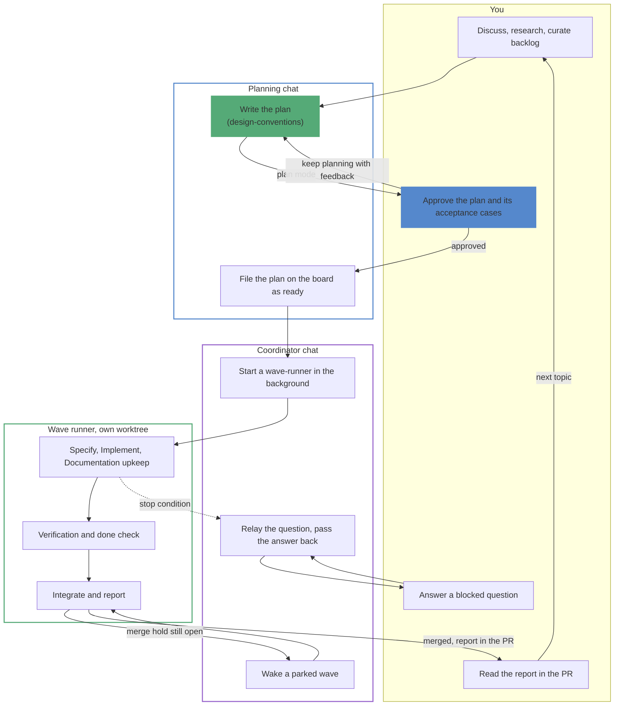
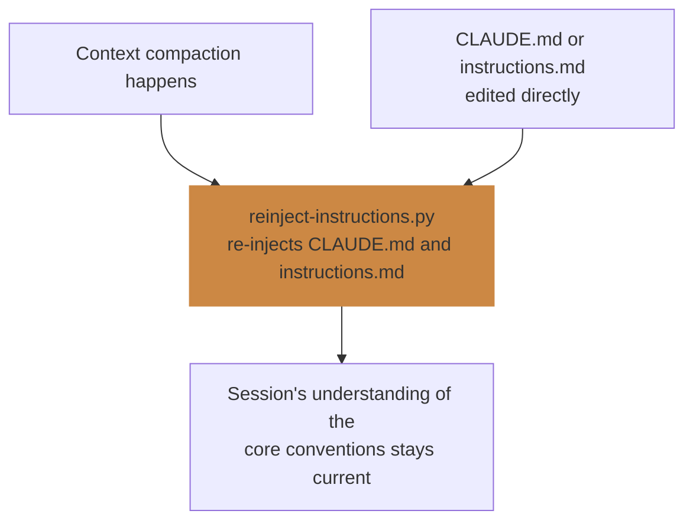
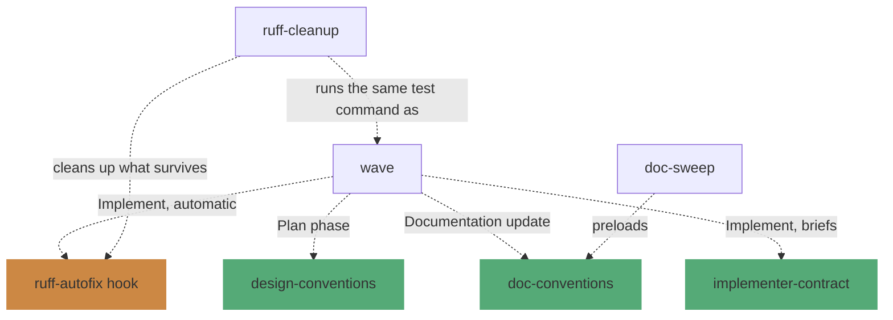

# Working with the harness

[`00-agents-overview.md`](00-agents-overview.md) covers the mechanism: how a wave uses plan mode, hooks,
and skills together. This page covers the experience: what it's actually like to work with this harness
session to session, and what it standardizes once it's in place.

## How you work: two chats

You work in two kinds of chat. Planning stays a conversation; execution runs in the background and comes
back to you only with questions and a report.

| Chat | Started with | What happens there |
|---|---|---|
| Planning chat | Any session in a repo | Discuss, research and curate `backlog.md` in normal mode. When you are ready to lock in one change ("let's plan wave 12"), the agent enters plan mode, writes the plan and revises it on your feedback. On approval the plan is filed on the [coordination board](05-parallel-waves.md) as `ready` and the chat moves on to the next topic. "Run wave 12 interactively" keeps that wave in the same session instead: it runs in its own worktree and asks you its questions directly. |
| Coordinator chat | `cd ~/Projects && claude --name coordinator`, then `/coordinate` | The one long-lived session that starts `ready` waves as background wave runners (at most two at once), relays a blocked wave's question so you can answer without opening the code, wakes parked waves once the wave they wait for has merged, and answers "what is running" from the board. |

**What you review** is the plan and its acceptance cases, not the code. An acceptance case says in words
and data what must be true afterwards, so you can check it without reading a diff. After approval the
agent works without asking. A wave lands on `main` only when its done check holds, with the evidence for
each row, and the report in the pull request description tells you what was built, how each acceptance
case was checked and what to look at. Nothing runs past what was approved: a wave stops with one question
when the plan cannot be carried out as written, rather than deciding for itself.

**Blue** marks the plan-mode permission boundary, with the same meaning as in
[`00-agents-overview.md`](00-agents-overview.md): the plan and your approval of it, which can loop through
"keep planning with feedback" as often as needed. **Green** marks a skill genuinely invoked at that step.
Waves are described in [`05-parallel-waves.md`](05-parallel-waves.md).

After a wave merges, three things are normal: go back to discussing or curating the backlog, plan the next
wave, or, once several waves have landed, reach for `ruff-cleanup`. That one is scoped to a whole PR diff
rather than any single wave, to mop up whatever survived the per-edit `ruff-autofix` hook; if it makes
changes, they land as their own commit. Suggest `/clear` after a wave or when switching topic: `backlog.md`,
`docs/history/` and the code carry everything across sessions.

## Two ways a skill activates

A skill's content isn't loaded by default — it only enters context when triggered. These are two
independent entry points, not a choice the agent makes between them — they just happen to land the same
content:

```mermaid
graph TD
  E["Explicit: you type a slash command,<br/>or the agent calls Skill by name"] --> L["Skill content loads fresh"]
  I["Inferred: your message happens<br/>to match a skill's description"] --> L
  L --> W["Agent applies it this turn"]

  style E fill:#1a2a3a,stroke:#5588cc,stroke-width:2px
  style I fill:#1a2a3a,stroke:#5588cc,stroke-width:2px
  style L fill:#55aa77,stroke:#55aa77,stroke-width:2px
```

- **Explicit** — you type `/wave`, `/ruff-cleanup`, or the agent calls the Skill tool directly by name.
- **Inferred** — the agent recognizes your message matches a skill's `description` and loads it without
  being asked by name.

Neither path is "more official" than the other — both land the same content. What matters more the
longer a session runs is *re-invoking* a skill at the moment its content is actually needed, rather than
working from a memory of having read it earlier in the conversation — see `CLAUDE.md`'s "Skill freshness"
note for why.

## Keeping the harness itself current

Skills solve their freshness problem by being invoked fresh each time — the section above. `CLAUDE.md` and
`instructions.md` are different: they're baked into every session's initial context via the `@import`
chain, so there's a standing risk of a session's belief about them going stale mid-session, two ways —
ordinary context compaction can summarize them away, and editing them directly (as this session did,
repeatedly) doesn't automatically refresh what's already in context. `reinject-instructions.py` covers
both:

Same underlying problem "Skill freshness" names for skills, solved differently here because these two
files don't have an explicit invocation mechanism to lean on — they're supposed to just always be there.

## How skills compound

Some skills stand alone; others explicitly build on one another. This is a structural view, not a
sequence — it shows what each skill *reaches for*, not when you'd run it:

`wave` is the hub: it reaches into four others in the course of a single run.
`doc-sweep` piggybacks on `doc-conventions` rather than redefining documentation rules of its own.
`ruff-cleanup` has two relationships that aren't about invoking anything: it picks up *after* whatever
the `ruff-autofix` hook already fixed, and it runs the same repo test command a wave's Verification phase
does. `sdk-release` and `design-conventions` itself don't reach for anything further — they're
leaves in this graph, not hubs.

## What actually gets standardized, and how

| Concern | Standardized via | Enforcement |
|---|---|---|
| Lint/formatting fixes | `ruff-cleanup`'s `RULES.md` | Skill (judgment) + `ruff-autofix` hook (mechanical, safe fixes only) |
| Design/architecture principles | `design-conventions` | Skill (judgment), invoked fresh at Plan phase |
| Documentation conventions | `doc-conventions` | Skill, auto-loaded on every markdown edit |
| Workflow/process (waves, planning, integration) | `instructions.md` + `wave` + `coordinate` | Always-loaded prose + skills |
| What "done" means for a wave | Acceptance cases, `test-author`, the done check | Frozen tests plus a table of evidence |
| Parallel waves not colliding | Coordination board and `coordination-guard.py` | Hook blocks a push or PR completion that breaks a lock or hold |
| Dependency/changelog discipline | Hooks | Mechanical, can't be skipped by forgetting |

Each row is deliberately backed by a different kind of mechanism — see `00-agents-overview.md`'s "why
this one" table for the same reasoning applied to a single wave's phases.

## Aspirational: the same pattern for a team

Today this is one person's `~/.claude/` symlink setup — nothing here is currently shared with anyone
else. But nothing about the *pattern* is single-user-only. A team could each point their own
`~/.claude/skills` and `~/.claude/agents` at one shared repo (or each keep their own clone of it) and get
the same shared `RULES.md`, `design-conventions`, and hooks — the same lint fixes, the same architectural
principles, the same dependency discipline — without forcing everyone onto one shared `CLAUDE.md`. That
last part matters: `03-cross-repo-distribution.md`'s Gotcha 2 already keeps colleague-shared repos
independent for exactly this reason — personal working style and shared team standards are different
things, and this harness's distribution model already separates them (global skills/hooks, per-repo or
per-person conventions on top).

This is a description of what the pattern *could* support, not a claim that it's happening — see
[`03-cross-repo-distribution.md`](03-cross-repo-distribution.md) for how the current, personal-only
distribution actually works.
