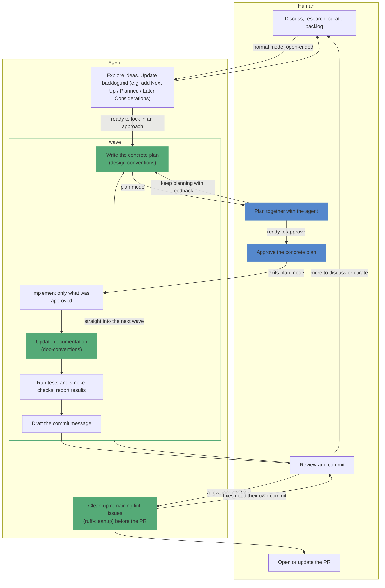
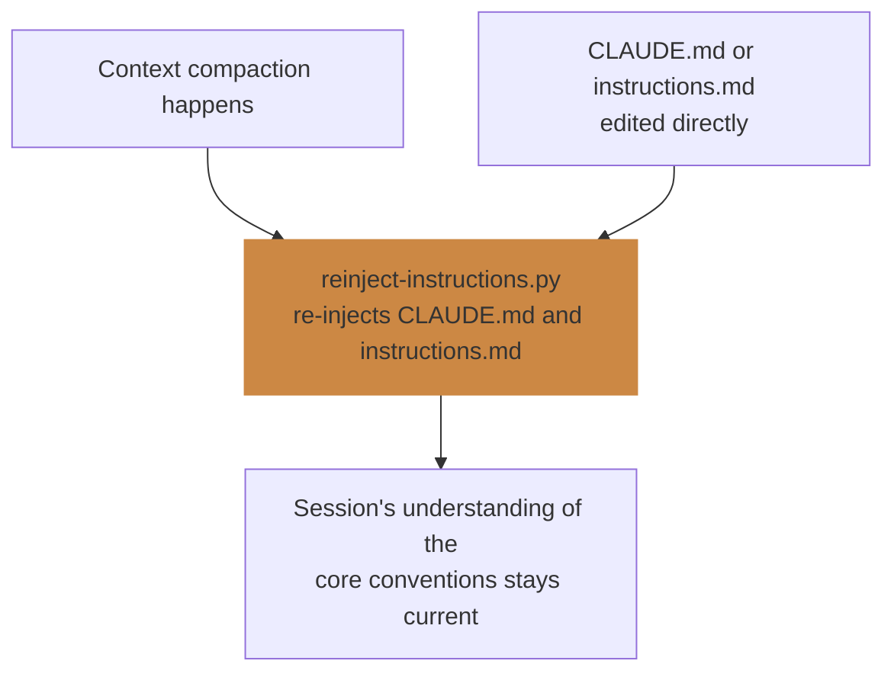
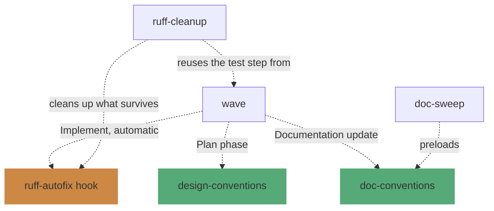

# Working with the harness

[`00-agents-overview.md`](00-agents-overview.md) covers the mechanism: how a wave uses plan mode, hooks,
and skills together. This page covers the experience: what it's actually like to work with this harness
session to session, and what it standardizes once it's in place.

## Interactive, not autonomous

A session is a conversation with an agent, not a pipeline running unattended, and none of it runs in a
fixed sequence — you move between pieces by typing `/name` or just saying what you want next, looping and
branching rather than running straight through once. Most of the back-and-forth — discussion, research,
backlog curation — happens in normal conversation, with no permission boundary at all. Plan mode is
entered specifically once you're ready to lock in a concrete implementation approach for one specific
change, and it should be short: the final step that finalizes and approves an already-discussed plan, not
a container for the whole conversation. Only the *approved* plan gets implemented, and even then
Verification and Commit proposal are further checkpoints, not a rubber stamp on the way to a foregone
conclusion.

The agent never runs unsupervised past what was actually approved — it doesn't wander into adjacent
"improvements," and it doesn't skip the review at the end because the plan looked straightforward going
in.

After a commit lands, three things can happen next, and all three are normal: go back to discussing or
curating the backlog, jump straight into planning the next wave without further discussion, or — once
several commits have accumulated on a branch — reach for `ruff-cleanup`. That last one is scoped to the
whole PR diff rather than any single wave, specifically to mop up whatever survived the per-edit
`ruff-autofix` hook along the way; if it makes changes, those need their own commit before the PR actually
goes up.

**Blue** marks the plan-mode permission boundary — same meaning as in `00-agents-overview.md`'s diagram —
and stays small on purpose: two nodes, `Plan together with the agent` and `Approve the concrete plan`, out
of the whole loop. Even inside that boundary, "keep planning with feedback" can loop as many times as
needed before anyone actually approves.

**Green** marks a skill genuinely invoked at that step: `design-conventions` while the plan is being
written, `doc-conventions` during documentation update — the latter runs via a forked agent that inherits
the whole conversation, so it already knows exactly what was just implemented rather than being told from
scratch (see `wave`'s Phase 3) — and `ruff-cleanup` itself, standing entirely outside the `wave` box since
nothing in `wave` ever invokes it.

The green-bordered, unfilled box is a different use of the same color: it marks everything the `wave`
skill itself actually drives, once it's invoked — writing the plan through drafting the commit message.
`Explore ideas...` and `ruff-cleanup` both sit outside it, for different reasons: exploring is still normal
mode, before `wave` is called, while `ruff-cleanup` is its own separate skill that `wave` never invokes.
The human's own nodes sit outside it too — approving and giving feedback are inputs the skill responds to,
not steps the skill itself performs.

## Two ways a skill activates

A skill's content isn't loaded by default — it only enters context when triggered. These are two
independent entry points, not a choice the agent makes between them — they just happen to land the same
content:

```mermaid
graph TD
  E["Explicit: you type a slash command,<br/>or the agent calls Skill by name"] --> L["Skill content loads fresh"]
  I["Inferred: your message happens<br/>to match a skill's description"] --> L
  L --> W["Agent applies it this turn"]

  style E fill:#1a2a3a,stroke:#5588cc,stroke-width:2px
  style I fill:#1a2a3a,stroke:#5588cc,stroke-width:2px
  style L fill:#55aa77,stroke:#55aa77,stroke-width:2px
```

- **Explicit** — you type `/wave`, `/ruff-cleanup`, or the agent calls the Skill tool directly by name.
- **Inferred** — the agent recognizes your message matches a skill's `description` and loads it without
  being asked by name.

Neither path is "more official" than the other — both land the same content. What matters more the
longer a session runs is *re-invoking* a skill at the moment its content is actually needed, rather than
working from a memory of having read it earlier in the conversation — see `CLAUDE.md`'s "Skill freshness"
note for why.

## Keeping the harness itself current

Skills solve their freshness problem by being invoked fresh each time — the section above. `CLAUDE.md` and
`instructions.md` are different: they're baked into every session's initial context via the `@import`
chain, so there's a standing risk of a session's belief about them going stale mid-session, two ways —
ordinary context compaction can summarize them away, and editing them directly (as this session did,
repeatedly) doesn't automatically refresh what's already in context. `reinject-instructions.py` covers
both:

Same underlying problem "Skill freshness" names for skills, solved differently here because these two
files don't have an explicit invocation mechanism to lean on — they're supposed to just always be there.

## How skills compound

Some skills stand alone; others explicitly build on one another. This is a structural view, not a
sequence — it shows what each skill *reaches for*, not when you'd run it:

`wave` is the hub — it's the one skill that reaches into three others in the course of a single run.
`doc-sweep` piggybacks on `doc-conventions` rather than redefining documentation rules of its own.
`ruff-cleanup` has two relationships that aren't about invoking anything: it picks up *after* whatever
the `ruff-autofix` hook already fixed, and it points at `wave`'s own test-detection instruction instead
of restating it. `sdk-release` and `design-conventions` itself don't reach for anything further — they're
leaves in this graph, not hubs.

## What actually gets standardized, and how

| Concern | Standardized via | Enforcement |
|---|---|---|
| Lint/formatting fixes | `ruff-cleanup`'s `RULES.md` | Skill (judgment) + `ruff-autofix` hook (mechanical, safe fixes only) |
| Design/architecture principles | `design-conventions` | Skill (judgment), invoked fresh at Plan phase |
| Documentation conventions | `doc-conventions` | Skill, auto-loaded on every markdown edit |
| Workflow/process (waves, planning, commits) | `instructions.md` + `wave` | Always-loaded prose + skill |
| Dependency/changelog discipline | Hooks | Mechanical, can't be skipped by forgetting |

Each row is deliberately backed by a different kind of mechanism — see `00-agents-overview.md`'s "why
this one" table for the same reasoning applied to a single wave's phases.

## Aspirational: the same pattern for a team

Today this is one person's `~/.claude/` symlink setup — nothing here is currently shared with anyone
else. But nothing about the *pattern* is single-user-only. A team could each point their own
`~/.claude/skills` and `~/.claude/agents` at one shared repo (or each keep a personal fork of it) and get
the same shared `RULES.md`, `design-conventions`, and hooks — the same lint fixes, the same architectural
principles, the same dependency discipline — without forcing everyone onto one shared `CLAUDE.md`. That
last part matters: `03-cross-repo-distribution.md`'s Gotcha 2 already keeps colleague-shared repos
independent for exactly this reason — personal working style and shared team standards are different
things, and this harness's distribution model already separates them (global skills/hooks, per-repo or
per-person conventions on top).

This is a description of what the pattern *could* support, not a claim that it's happening — see
[`03-cross-repo-distribution.md`](03-cross-repo-distribution.md) for how the current, personal-only
distribution actually works.
