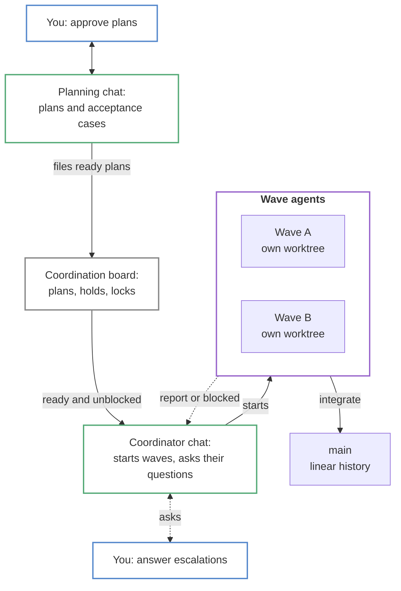
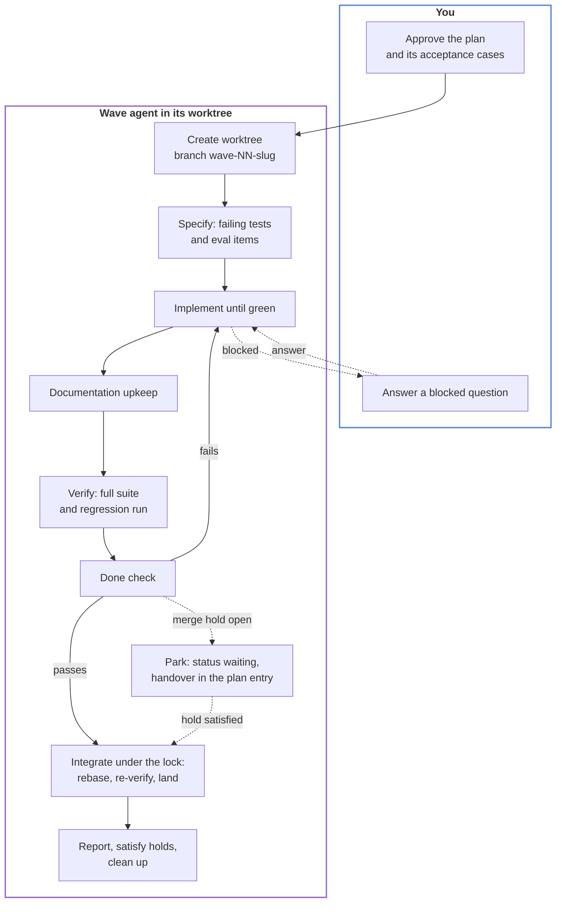
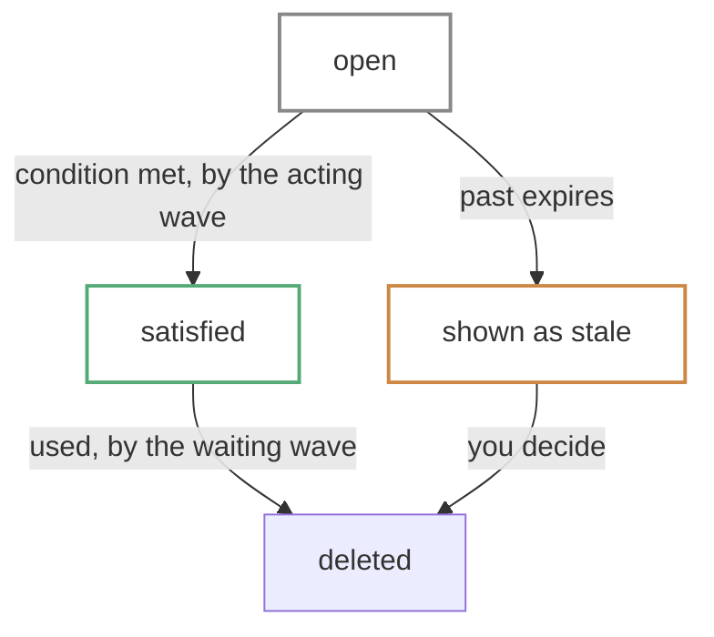

# Parallel waves

How several waves run at the same time, each in its own worktree, and land on `main` without anyone
reading the code: you approve plans, agents do everything after that. The procedures themselves live in
the `wave` skill (and its `board.md`, `tiers.md`, `report.md`) and the `coordinate` skill; this page
explains how the pieces fit and why.

## Contents

- [Two chats](#two-chats)
- [Wave lifecycle](#wave-lifecycle)
- [Tests first](#tests-first)
- [Eval items and the dev dataset](#eval-items-and-the-dev-dataset)
- [Worktrees](#worktrees)
- [Who merges, and in which order](#who-merges-and-in-which-order)
- [A wave that waits for another](#a-wave-that-waits-for-another)
- [The coordination board](#the-coordination-board)
- [The coordinator](#the-coordinator)
- [Constraints this rests on](#constraints-this-rests-on)

## Two chats

| Chat | What happens there |
|---|---|
| **Planning chat** | Started in `~/Projects`. You and the planning agent turn backlog entries into plans in plan mode. Each approved plan names its acceptance cases, exit criteria and dependencies, and is filed on the coordination board as `ready` |
| **Coordinator chat** | Also started in `~/Projects`. The coordinator starts `ready` waves in the background, each in its own worktree, and shows which wave runs, waits or is blocked. A wave's question arrives here as a dialog of its own, with a desktop notification, and you answer it there. Until you do, it heads every coordinator message, and the statusline of every session shows the blocked wave |

**Batch waves are the default.** Once its plan is approved, a wave needs nobody until it has merged or is
blocked. An **interactive wave** runs only when you ask for it ("run wave 12 interactively"): you then drive
it in the planning session. Both kinds follow the same phases, done check, board rules and report, so they
run side by side.



What you review:

| Not | But |
|---|---|
| Each commit, push and PR | The plan, before the wave starts |
| The code | The plan's acceptance cases: the expected behaviour in words and data, which the tests are written from |
| Messages scattered over sessions | The coordinator chat, and the wave report in each PR description |

## Wave lifecycle



A wave commits on its branch after Specify and after Implement, so a wave whose agent was interrupted
resumes from its branch rather than starting over. A failing done check sends the wave back to Implement;
after one retry one tier up it stops with `blocked`. Branch policies still apply: a required build
validation keeps the PR open until it passes, and a required human reviewer still has to approve.

## Tests first

When the agent that writes the code also writes its tests, the tests confirm what the code does rather
than what you asked for. So the expected behaviour is fixed before implementation, by agents that do not
write the code:

| Role | Writes | Works from |
|---|---|---|
| Planning agent, with you | Acceptance cases in the plan | Your conversation and the backlog entry |
| `test-author` | The cases as failing unit or integration tests and as eval items | The plan and the codebase, never the implementation |
| Implementer tiers | Code until the tests pass, plus tests for details they introduce | Their brief; the frozen tests are read only for them |

The planning agent does not write test code: plan mode is read only, the plan is approved before the
wave's worktree exists, and writing tests means reading a lot of code that would fill the planning chat.
A case that `test-author` cannot turn into a test is ambiguous, and it reports `blocked` rather than
guessing.

## Eval items and the dev dataset

The dev dataset in Langfuse is the single source of truth for eval items. A local working copy is a
short-lived copy of it, pulled right before an edit and pushed right after. Items are not committed to the
wave's branch and do not wait for the merge: other waves see them at once.

| When | What happens | Why |
|---|---|---|
| Specify | `test-author` writes the items per `semeval-maintain`, tags each `pending:<repo>/<wave>`, and pushes them. Nothing runs | The items exist before any code does; an item for behaviour that does not exist yet tells nothing by failing |
| Implement | The wave's own items, selected by id (`items:` in the run file), three repeats each | Fast feedback; repeats because model output varies |
| Verification | The full regression run, leaving out every other wave's `pending:` tag (`exclude_tags:`) | Another wave's unfinished behaviour is not this wave's failure |
| Integrate | Right after the merge, one push removes the wave's `pending:` tags | From then on every regression run includes them |
| Dropped wave | Its pending items are archived in the Langfuse UI | `push` never deletes |

Several waves work on one dev dataset at the same time. `eval-dataset push` merges against the state the
working copy was pulled from: it keeps what others changed in Langfuse since, writes only what changed
locally, and refuses the push when the same item changed on both sides. A refused push is pulled again,
the edit redone, and pushed; nothing is overwritten. The board's dataset lock serialises the pushes
themselves, for the seconds one pull and push takes.

## Worktrees

Every wave runs in its own worktree on the branch `wave-<NN>-<slug>`, created by
`.claude/scripts/new-wave-worktree.sh` from the current `origin/main`. All its sub-tasks share it; the
owned-files rule keeps parallel sub-tasks apart.

| Item | How |
|---|---|
| Location | `<repo>/.claude/worktrees/<branch>`; the script adds `.claude/worktrees/` to `.git/info/exclude` |
| Harness instructions | The user rule `~/.claude/rules/agents-harness.md` loads them in every worktree |
| `.env` and other gitignored files | Copied from the main checkout as the repo's `.worktreeinclude` lists |
| Untracked `.claude/rules/*.md` | Copied from the main checkout whether or not `.worktreeinclude` lists them, so a personal `integration.md` reaches every worktree |
| Python environment | `uv sync` in the worktree; fast through the shared uv cache |
| Service ports (`Semantic_Evaluation`: 8001, 8002) | A wave that runs services declares them as `exclusive` in its plan entry; the coordinator never runs two such waves at once |

## Who merges, and in which order

**Each wave agent merges its own work.** It is the only agent that knows the change well enough to resolve
a rebase conflict and judge a re-verification. The coordinator never merges. There is no planned order:

1. **Holds** cover real dependencies: a wave held on another cannot merge before it.
2. **The integration lock** makes integration serial per repo: a wave takes it, rebases on the current
   `main`, re-verifies, lands, cleans up and releases it. A second wave that passes its done check
   meanwhile waits, then rebases on the first.
3. Otherwise **first done, first merged**.

| Strategy | When | How |
|---|---|---|
| PR per wave (`integration: pr`, the default) | Repos with a branch policy | Completed with rebase and fast-forward, so the PR adds no merge commit. Azure Repos does this only through the REST API (`az rest`, `mergeStrategy: "rebase"`); the repo's instructions carry the exact command |
| Push `main` (`integration: push`) | Repos whose instructions carry `Integration: push` | `git push origin HEAD:main` after the rebase; if `main` moved, rebase again |
| Stacked branch | Wave B needs wave A's code before A is merged | B branches from A's branch; a hold keeps B from merging first; after A lands, `git rebase --onto origin/main <A's old tip>` |

| File every wave touches | Mitigation |
|---|---|
| `docs/history/index.md` | `merge=union` in `.git/info/attributes`, written by the worktree script, keeps both lines |
| `backlog.md` | Resolved during the rebase; the Next Up renumbering is mechanical |
| `CHANGELOG.md` | Only the releasing wave writes it, under `## [Unreleased]`; it sets the version at Integrate, under the lock. Others leave a `notice` |

## A wave that waits for another

A wave agent never hands back to you, only to the coordinator.

| Hold blocks | Used when | What happens |
|---|---|---|
| `start` | Wave A needs wave B's code to be built at all | The coordinator does not start A. Once B has merged, it starts A from the new `main` |
| `merge` | A can be built on its own but must land after B | A runs up to the done check, pushes its branch, opens a draft PR and **parks** |

A parking wave keeps its worktree, sets its plan entry to `waiting`, writes a **handover** into it (branch,
PR, the `main` commit it was verified on, what integration still needs) and returns its report. A parked
wave costs nothing and does not count against the limit of parallel waves.

When the hold is satisfied, the coordinator starts a **fresh** `wave-runner` whose only task is Integrate,
briefed with the plan entry and its handover. Resuming the parked agent would cost more: a resumed agent
sends its whole context again, the prompt cache has long expired, and nothing compacts a subagent on
request. The handover is the parked wave's own compaction, written while it still knows everything. The
same rule holds inside a wave: each implementer is fresh and runs once, and a retry is a new brief one
tier up.

## The coordination board

> **Definition: hold**
> A "not before" rule between two waves: wave X in repo Y may not start, or may not merge, until a stated
> condition is true. Example: "Project Green wave 12 merges only after semantic-evaluation 0.9.0 is on
> Artifactory". On the board it is one small file that a hook enforces.

The board, `~/.claude/coordination/`, holds the rules that must outlast a session: plans, holds,
requests, notices and locks, one folder per repo, one file per entry, so parallel sessions never edit the
same file. Entry formats and commands are in the `wave` skill's `board.md`; `board.py` reads and writes it.

```
~/.claude/coordination/
  Project-Green-HR-MVP/
    wave-12-batch-upload.md      plan
    w12-needs-sdk-0.9.md         hold
    lock-dataset-hr_dev.md       dataset lock, during one push
  Semantic_Evaluation/
    wave-58-sdk-0.9.md           plan
    from-green-w12-batch-api.md  request
    lock.md                      integration lock, while wave 58 integrates
```



The board stays clean through three rules: every entry has an owner who deletes it; every entry has an
`expires` date, after which a notice disappears and anything else is shown as stale, never dropped; and it
holds only work in flight.

Three hooks keep sessions in step with it without polling (see [01-hooks.md](01-hooks.md)):
`coordination-inject.py` shows the repo's entries at session start, `coordination-watch.py` reports a
change after the next tool call, and `coordination-guard.py` blocks landing on `main` while a merge hold or
another wave's lock is open. With no human approving merges, the guard is what stops a wave from merging
before what it waits on exists. Live nudges between running sessions go through `SendMessage`; the board,
not the message, holds the rule.

## The coordinator

One session for all repos, started in the folder that holds them (`cd ~/Projects && claude --name
coordinator`, then `/coordinate`), so every repo and its worktrees are inside its working directory. It:

1. starts each `ready` batch plan whose start holds are satisfied and whose exclusive resources are free,
   as a background `wave-runner`, at most four at once;
2. asks you a `blocked` wave's question with `AskUserQuestion`, as the first thing it does on the report
   and after a desktop notification, with enough context to answer without opening the code; the wave has
   already appended the question to its plan entry. It appends your answer below the question and passes
   it back to the stopped wave with `SendMessage`: a blocked wave waits minutes, so resuming it is worth
   its context;
3. wakes a `waiting` wave with a fresh `wave-runner` once its merge hold is satisfied;
4. keeps plan statuses true, and after its own restart reads the board, restarts `interrupted` waves from
   their branches and wakes `waiting` ones.

It never edits code, never merges, and holds little itself: each wave returns a short report, not its
diffs, and the coordinator passes on only its head: one line per wave that went as planned, the full
context for what needs you. Waves are named by what they do, with the number in brackets. Nesting is coordinator, `wave-runner`, implementer: two of the three subagent levels Claude Code
allows. A `wave-runner` starts outside its repo, so it creates its worktree with the script and reads the
repo's `CLAUDE.md` as its first step.

## Constraints this rests on

| Constraint | Consequence |
|---|---|
| Subagents have no `AskUserQuestion` and no plan mode | A batch wave cannot ask you anything; it reports `blocked` and the coordinator asks |
| `AskUserQuestion` takes up to four questions with two to four options each, and holds the session until you answer | A wave's report states one question with its options; a question without options goes out as a message headed `QUESTION:`. While a dialog is open the coordinator handles no other report |
| The text of a busy turn can be cut off or lost among tool calls | A question never travels inside a longer message: it is a dialog of its own, it stays in the plan entry's body, and every coordinator message and every statusline repeats the open ones |
| A finished subagent can be continued with `SendMessage`, with its context intact | A blocked wave resumes with your answer |
| Subagents compact on their own as their context fills; `autoCompactWindow` in an agent file makes one compact earlier; nothing compacts a subagent on request | Every agent file sets `autoCompactWindow`; a parked wave hands over a written state instead |
| Background subagents need `CLAUDE_CODE_DISABLE_BACKGROUND_TASKS` unset | It is not set in `~/.claude/settings.json` |
| A background subagent is denied any permission not already granted | Batch waves rely on auto mode and allow rules for git, the test runners, `az repos`, `gh` and `eval-dataset`. Completing an Azure Repos PR runs `az rest`, which has no allow rule because one would cover every Azure API; auto mode decides on it |
| A message from another session never counts as your consent | Parallel sessions run in the same permission mode |
| Subagent model order: per-call `model`, then the agent file's `model:`, then `CLAUDE_CODE_SUBAGENT_MODEL` | Tiers are agent files with their own `model:` and `effort:` |
| Claude Code's own worktree creation works only for the session's current repo | The coordinator's waves create worktrees with `new-wave-worktree.sh` |
