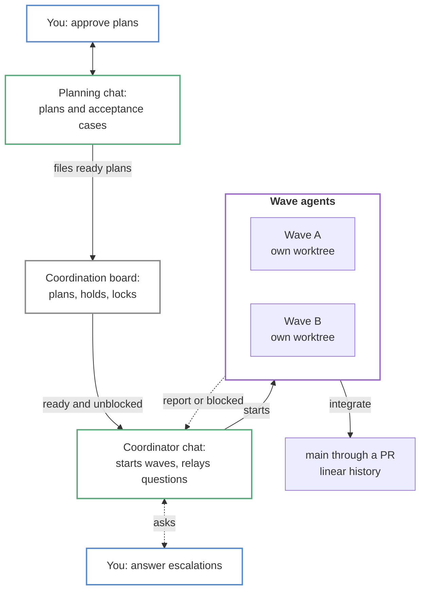
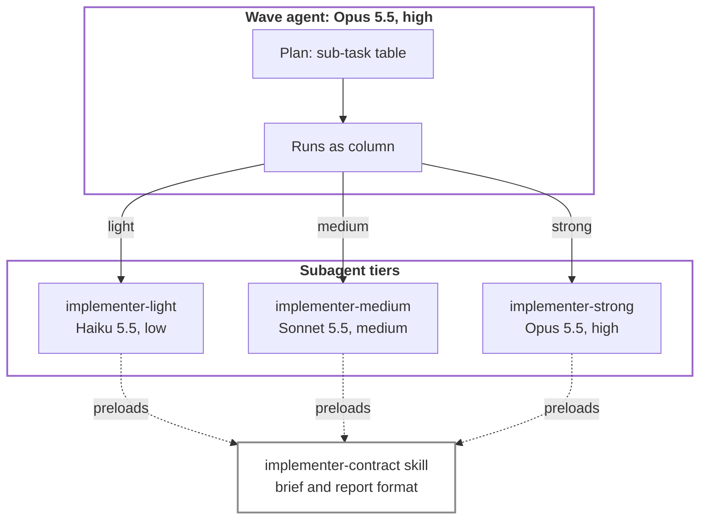
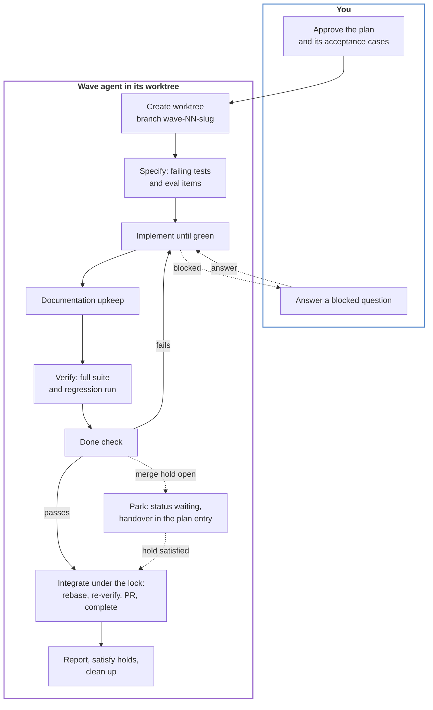
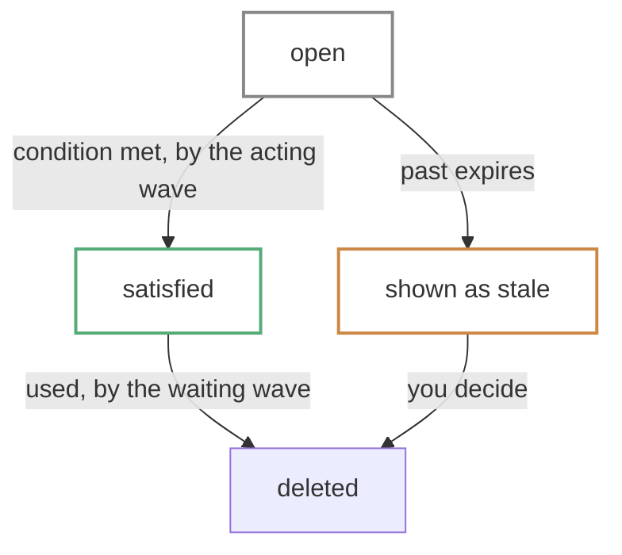

# Implementation plan: autonomous parallel waves

A working draft, still under discussion. It describes how the harness changes so that several waves run
at the same time, each in its own worktree, and land on `main` without anyone reading the code: you
approve plans, agents do everything after that. Apart from the items marked **in place**, nothing here is
built yet. What is still open is listed under [Open decisions](#open-decisions).

## Contents

- [The target picture](#the-target-picture)
- [Decisions](#decisions)
- [Facts this rests on](#facts-this-rests-on)
- [1. The done check](#1-the-done-check)
- [2. Tests first](#2-tests-first)
- [3. Subagent tiers](#3-subagent-tiers)
- [4. A worktree per wave, and integration](#4-a-worktree-per-wave-and-integration)
- [5. The coordination board and its hooks](#5-the-coordination-board-and-its-hooks)
- [6. The coordinator and batch waves](#6-the-coordinator-and-batch-waves)
- [7. The wave contract](#7-the-wave-contract)
- [8. Documentation sweeps as their own waves](#8-documentation-sweeps-as-their-own-waves)
- [Implementation sequence](#implementation-sequence)
- [Open decisions](#open-decisions)

## The target picture

You work with two chats:

| Chat | What happens there |
|---|---|
| **Planning chat** | You and the planning agent turn backlog entries into plans. Each approved plan names its acceptance cases, exit criteria and dependencies, and is filed on the coordination board as `ready` |
| **Coordinator chat** | The coordinator starts `ready` waves in the background, each in its own worktree, and shows which wave runs, waits or is blocked. Questions from waves arrive here, and you answer them here |

**Batch waves are the default.** Once its plan is approved, a wave needs nobody until it has merged or is
blocked. An **interactive wave** is the exception and only happens when you ask for it explicitly, for
example "run wave 12 interactively": you then drive it yourself in its own session and worktree. Both
kinds follow the same [contract](#7-the-wave-contract), the same [done check](#1-the-done-check) and the
same board rules, so they run side by side.

> **Definition: wave agent**
> The agent that runs one wave from its approved plan to the merged pull request. In a batch wave it is a
> background subagent the coordinator started; in an interactive wave it is the session you talk to. It
> delegates sub-tasks to implementer subagents, as the `wave` skill does today.



Each wave agent also writes back to the board: it takes and releases the integration lock and satisfies
the holds that wait on it.

What you review changes with it:

| You no longer | You review instead |
|---|---|
| Approve each commit, push and PR | The plan, before the wave starts |
| Read the code | The plan's [acceptance cases](#2-tests-first): the expected behaviour in words and data, which the tests are written from |
| Collect "done" messages and holds between sessions | The coordinator chat and the [wave report](#the-report) in each PR description |

## Decisions

| Topic | Decision | Status |
|---|---|---|
| Coordination model | Peer sessions, a coordination board, hooks and live messages; a coordinator runs batch waves on top | Decided |
| Default wave mode | Batch. Interactive only when you ask for it explicitly | Decided |
| Commit and integration | The wave agent commits, pushes, opens and completes its PR once the done check passes. Your approval moves to the plan | Decided |
| Board location | `~/.claude/coordination/`, one folder per repo | Decided |
| Worktree level | One worktree per wave, shared by all its sub-tasks | Decided |
| Git history | Linear: rebase and fast-forward, never a merge commit on `main` | Decided |
| Documentation sweeps | Never part of a wave; always a [sweep wave](#8-documentation-sweeps-as-their-own-waves) of their own | Decided |
| Choosing a tier | The cheapest tier that can do the sub-task well, never a cheaper one. Stated as a principle, without prices | Decided |
| Tests first | Acceptance cases in the plan; a separate `test-author` agent turns them into failing tests and eval items before implementation | Decided |
| Eval items | Pushed to the dev dataset right after they are written, not run until implementation; the dev dataset in Langfuse is the single source of truth | Decided |
| Pass rule for new eval items | Every one of three repeats passes | Decided |
| Who merges, and in which order | Each wave agent merges its own PR. Holds and a per-repo integration lock decide the order | Decided |
| A wave that waits for another | It parks with status `waiting` and hands back to the coordinator, never to you; the coordinator wakes it | Decided |
| Wave contract | The plan entry is the brief; a fixed report with a checklist comes back and goes into the PR description | Decided |
| Harness in every worktree | `~/.claude/rules/agents-harness.md` imports the harness in every project and worktree; see [03-cross-repo-distribution.md](03-cross-repo-distribution.md) | **In place** |
| `.env` in worktrees | `Semantic_Evaluation` and `Checkmate` carry an untracked `.worktreeinclude` with `**/.env` | **In place** |

## Facts this rests on

Checked on 2026-11-13 against the Claude Code docs (`code.claude.com/docs/en/`: `sub-agents`, `agent-teams`,
`cross-session-messaging`, `hooks`, `worktrees`, `env-vars`, `model-config`) and against this machine's
setup. Rows marked *measured* were tested here; rows marked *recheck* need a test before the step that
relies on them.

| Fact | Consequence |
|---|---|
| Subagents can spawn their own subagents, up to three levels below the main conversation (`CLAUDE_CODE_MAX_SUBAGENT_SPAWN_DEPTH`) | Coordinator, wave agent, implementer fit, with one level to spare |
| Subagents have no `AskUserQuestion` and no plan mode | A batch wave cannot ask you anything; it reports `blocked` and the coordinator asks |
| A finished subagent can be continued with `SendMessage`, with its context intact | A blocked wave resumes with your answer instead of starting over |
| Subagents compact automatically as their context fills; `autoCompactWindow` in an agent file (100,000 to 1,000,000 tokens) makes one compact earlier. Nothing compacts a subagent on request: `/compact` acts on the main conversation only | A parked wave cannot be shrunk before it is woken; it hands over a written state instead, see [section 4](#a-wave-that-waits-for-another) |
| A resumed subagent sends its whole context again; after a long wait the prompt cache has expired, so all of it is paid at the full input price | Waking a parked wave by resuming it costs more than a fresh agent with a short brief |
| `CLAUDE_CODE_DISABLE_BACKGROUND_TASKS=1` is set in `~/.claude/settings.json`; it also stops background subagents | Removed in [step 6](#implementation-sequence); until then a coordinator would wait for each wave |
| *Recheck:* a background subagent gets its permissions approved when it starts and is denied anything not approved | Batch waves need allow rules (or auto mode) for git, the test runners and `az repos` |
| A local session messages another with `SendMessage`; `ListAgents` lists them by name. A busy session reads the message after its next tool call, an idle one starts a new turn | Live notices need nothing built |
| A `PostToolUse` hook's `additionalContext` reaches the model in the same turn, up to 10,000 characters | A hook can report board changes mid-turn |
| A message from another session never counts as your consent; sessions in different permission modes may hold messages for approval | Parallel sessions run in the same permission mode |
| Plan mode is read only | The planning agent cannot write test files; it writes acceptance cases into the plan |
| Agent teams are *experimental*, and teammates are not isolated in worktrees | Not an engine for batch waves yet |
| Subagent model order: per-call `model`, then frontmatter `model:`, then `CLAUDE_CODE_SUBAGENT_MODEL`, then the main model; `effort` frontmatter works on Haiku, Sonnet and Opus 5.5 | Tiers are agent files with their own `model:` and `effort:` |
| `claude --worktree <name>`, `EnterWorktree` and Agent `isolation: "worktree"` all create worktrees of the **current** repo | A coordinator serving several repos needs its own way to create worktrees, see [section 6](#where-the-coordinator-runs) |
| *Measured:* the user rule `~/.claude/rules/agents-harness.md` loads the harness in every project and worktree, and a second import of the same file adds no copy | Every wave gets the harness, however its worktree was created |
| *Measured:* an untracked `.worktreeinclude` copies the gitignored files it lists into worktrees Claude Code creates; `git worktree add` copies nothing | `.env` reaches new worktrees without a commit in a team repo |
| A `semantic-evaluation` run file selects **scopes**, not single items (`sdk/semantic_evaluation/docs/04-offline-evaluation.md`) | Running only a wave's new eval items needs an SDK change, see [section 2](#semantic-evaluation) |
| `eval-dataset push` upserts by item id and does not know which version its working copy was pulled from | Two parallel pushes to one dev dataset can overwrite each other's edits; see [section 2](#semantic-evaluation) |

Prices per million tokens (input / output), first-party API: Haiku 5.5 $0.10 / $0.50, Sonnet 5.5 $2 / $10,
Opus 5.5 $4 / $20. On a subscription plan they show up as usage limits instead; how a plan weighs each
model was not checked.

## 1. The done check

Your OK before `git commit`, push and PR becomes a check the wave agent runs itself. A wave may commit,
push, open its PR and complete it only when all of these hold:

| Check | Evidence in the report |
|---|---|
| Every acceptance case passes | Each case with its test or eval item and the result |
| Frozen tests are unchanged since the tests-first commit, or each change is listed with its reason | `git diff <tests-first commit> HEAD -- <frozen files>` |
| Frozen eval items are unchanged since the Specify push, or each change is listed with its reason | The items' version stamps in the dev dataset |
| Verification passed: the repo's lint, format check and test suite, and the plan's smoke commands | Each command with its result |
| For an LLM agent: every new eval item passed all three repeats, and the full regression run, without other waves' pending items, passed its gate | The Langfuse run names and the result per metric |
| Documentation upkeep done: READMEs and falsified claims rewritten | The files rewritten |
| `backlog.md`: the wave's section removed, other sections adjusted | Yes or not applicable |
| The plan archived in `docs/history/` with its index line | The file name |
| `CHANGELOG.md` entry, if the wave ships a released package | Yes or not applicable |
| No open hold on the board names this wave | Enforced by the guard hook |
| The branch is rebased on the current `main` and re-verified | The `main` commit it sits on |

A failing check sends the wave back to Implement. After one retry one tier up (see the
[escalation rule](#escalation-rule)) it stops with `blocked` instead of trying further. Branch policies
still apply: a required build validation keeps the PR open until it passes, and a required human reviewer
still has to approve.

**Files that change:** `instructions.md` ("Implementation Waves" phases, "Commit messages": the
confirmation sentence goes), `CLAUDE.md` ("Shell commands and git": keep `-m` and no trailer, drop the OK),
`.claude/skills/wave/SKILL.md` (Phase 5 becomes the done check), `docs/04-working-with-the-harness.md`.

## 2. Tests first

### Why

You no longer read the code, so the tests are what you rely on. When the agent that writes the code also
writes its tests, the tests confirm what the code does rather than what you asked for. So the expected
behaviour is fixed **before** implementation, by agents that do not write the code, and the implementers
work until it passes.

### Who writes what

| Role | Writes | Works from |
|---|---|---|
| **Planning agent**, with you | **Acceptance cases** in the plan: for each behaviour the situation, the action and the expected outcome, in words and data you can check. For an LLM agent the eval item's input and expected output | Your conversation and the backlog entry |
| **`test-author`** subagent, new | The cases as unit and integration tests and as eval items. Runs the tests and confirms they fail for the stated reason before any implementation exists; pushes the eval items without running them | The plan and the codebase, never the implementation |
| **Implementers** | Code until the tests pass. They may add tests for details they introduce, such as the edge cases of a function they wrote | Their brief; the frozen test files are read only for them |

The planning agent does not write the test code itself, for three reasons: plan mode is read only, the
plan is approved before the wave's worktree exists, and writing tests means reading a lot of code that
would fill the planning chat. It fixes **what** is expected; `test-author` writes **how** it is checked.
A case that `test-author` cannot turn into a test is ambiguous, and it reports `blocked` rather than
guessing, the same rule `semeval-maintain` has for expected outputs.

`test-author` has the Skill tool, so every skill in `~/.claude/skills/` is open to it and is found by its
description, including skills added later. Its agent file preloads none: one rule says that in a repo with
`evaluation/evaluation_manifest.yaml` it loads `semeval-maintain` first, and `semeval-datasets` for the
pull and push. A repo without evaluation pays nothing for them.

### Acceptance cases in the plan

| ID | Behaviour | Given | When | Then | Checked by |
|---|---|---|---|---|---|
| AC1 | Batch upload rejects a duplicate id | a batch with two items sharing an id | it is uploaded | HTTP 422 naming the duplicate id; nothing stored | unit |
| AC2 | Uploaded items reach Langfuse | a running review sync service | a batch of three is uploaded | three items in the dev dataset | integration |
| AC3 | Parental leave goes to the policy tool | a user asks how long parental leave is | the agent answers | it calls `search_policy` with topic parental leave | eval item, metric `tool_called` |

Unit is the default. Integration only where the behaviour lives in the seam between components. An eval
item wherever the behaviour depends on a model: prompts, tools, routing, context.

### The Specify phase and frozen tests

Specify is a new phase between Plan and Implement:

1. `test-author` writes the tests for every case and runs them. Each must fail, and fail for the reason the
   case states: a missing function or a wrong result, not a typo in the test.
2. It writes the eval items and pushes them to the dev dataset at once, without running them (see
   [Semantic evaluation](#semantic-evaluation)). A model call costs money and time, and an item for
   behaviour that does not exist yet tells nothing by failing.
3. The wave agent checks that each test and item matches its case, then commits the tests as the wave's
   first commit, the **tests-first commit**.
4. From then on those tests and items are **frozen**. An implementer who believes one is wrong reports
   `blocked`. The wave agent may correct one that misread a clear case and lists the change in the
   report; a change to the case itself is a question for you.

Tests first does not apply to every wave. Documentation and sweep waves have no cases; a refactor that
changes no behaviour uses the existing suite as its cases; an experiment (`semeval-experiment`) measures
rather than asserts. The plan says which applies and why.

Nothing here is language specific: the test command comes from the repo's own `CLAUDE.md` (`pytest`,
`dotnet test`, `npm test`).

### Semantic evaluation

The dev dataset in Langfuse is the single source of truth for eval items. A local working copy is a
short-lived copy of it, pulled right before an edit and pushed right after. Items are therefore not
committed to the wave's branch, and they do not wait for the merge: other waves must see them at once.

| When | What happens | Why |
|---|---|---|
| Specify | `test-author` follows `semeval-maintain` steps 1 to 4: pulls the dev dataset, writes the items, tags each `pending:<repo>/<wave>`, pushes, updates `evaluation/coverage.md`. Nothing runs | The items exist in Langfuse before any code does |
| During Implement | Only the wave's own items, three repeats each | Fast feedback on the new behaviour; repeats because model output varies |
| Verification | The full regression run (`semeval-maintain` step 5), leaving out other waves' `pending:` items | New behaviour must not break the old, and another wave's unfinished behaviour is not this wave's failure |
| Integrate | Right after the merge, one push removes the wave's `pending:` tags | From then on every regression run includes the items |
| Dropped wave | Its pending items are archived in the Langfuse UI | `push` never deletes |

Every push, by any wave, follows the same rule: pull the dev dataset, merge what changed in Langfuse since
the working copy was pulled, and only then push. The board's dataset lock (see
[section 5](#board-layout)) keeps two waves from pushing to one dev dataset in the same moment; it is held
only for the pull, merge and push, seconds rather than the whole wave.

Two backlog waves in `Semantic_Evaluation` provide what the SDK lacks for this:

- **Wave 64: `push` merges what changed in Langfuse since the pull.** Today `push` overwrites items
  another push changed in between, and both can take the same version label. After it, `push` keeps
  remote changes, refuses on a real conflict and numbers the label after the dataset's current one. It
  also protects pushes from people and from repos outside the harness, which the dataset lock does not.
- **Wave 63: a run selects single items and leaves out other waves' pending items**, by `item_id` and by
  tag. Until it lands, a wave runs the full regression after implementation, which is slower and costs
  more, and a regression run can fail on another wave's pending items; the pilot avoids running two
  waves on one dev dataset until then.

**Files that change:** `instructions.md` (phases, a "Tests first" section), `.claude/skills/wave/SKILL.md`
(acceptance cases in Plan, the Specify phase, frozen tests in the done check), `.claude/agents/test-author.md`
(new), `.claude/skills/semeval-maintain/SKILL.md` (steps 1 to 4 in Specify with the push and the
`pending:` tag, step 5 in Verification), `.claude/skills/semeval-datasets/SKILL.md` (pull right before an
edit, push right after, pull again on a refused push), `docs/02-skills-and-subagents.md`, `docs/glossary.md` (*acceptance case*, *tests-first commit*, *frozen
test*).

## 3. Subagent tiers

Today one `implementer` subagent (Sonnet, medium effort) runs every delegated sub-task; a plan row can ask
for Opus, and nothing uses Haiku. Built-in agents run on Sonnet through `CLAUDE_CODE_SUBAGENT_MODEL`.

| Tier | Model | Effort | Typical work |
|---|---|---|---|
| **light** | Haiku 5.5 | low | Mechanical, fully specified edits; locating code; condensing a large payload |
| **medium** | Sonnet 5.5 | medium | A sub-task with a fixed contract and frozen tests; writing tests from acceptance cases; doc rewrites of touched code |
| **strong** | Opus 5.5 | high | Root-cause debugging, risky refactors, whole-repo doc sweeps, independent review |

The wave skill states the choice as a principle, not as prices, so it stays true when prices change:

> Pick the cheapest tier that can do the sub-task well, never a cheaper one. Saving on a sub-task that
> needs judgment costs more in failed runs, review and rework than the stronger tier would have. Paying
> for a stronger tier than the sub-task needs buys nothing.

Three thin agent files (`implementer-light`, `-medium`, `-strong`) carry only frontmatter and preload one
shared skill, `implementer-contract`, which holds today's brief and report format. Built-in agents such as
`Explore` keep their own definition and take the tier through the per-call `model` parameter.



### Mapping task types to tiers

The plan's `Runs as` column takes `light`, `medium`, `strong` or `inline`. The wave agent picks the
default and moves one step on the signals in the second table.

| Task type | Default | Move down to | Move up to |
|---|---|---|---|
| Mechanical edit to a fixed pattern (rename, version pins, one `RULES.md` fix across files) | light | | medium if the tests fail for a reason that is not obvious |
| Locate code (`Explore`) | light | | medium across many naming conventions |
| Condense a large payload (trace, log, long diff) | light | | |
| Write tests and eval items from acceptance cases (`test-author`) | medium | | strong: concurrency, auth, migrations, published SDK API |
| Implement a sub-task with a fixed contract and frozen tests | medium | light: one file, contract given as a signature and behaviour | strong: concurrency, auth, migrations, published SDK API |
| Refactor across many files, behaviour unchanged | medium | | strong if the area has few tests |
| Debug an unexplained failure | strong | medium if the failing test points at the line | |
| Rewrite READMEs and docstrings of code the wave touched | medium | light: a single factual claim | |
| Documentation sweep (`doc-sweep`) | medium for one path | | strong for a whole repo or a restructuring |
| Research with synthesis (release notes, docs, web) | medium | | strong when the result decides an architecture choice |
| Review of the wave's diff before the done check | strong | medium for a simplification pass only | |
| Design and architecture | **not delegated** | | strong only as a second opinion on the finished plan |

| Signal | Points to a lighter tier | Points to a stronger tier |
|---|---|---|
| Contract in the plan | Names, signatures and data shapes all fixed | Parts still open |
| Owned files | One or two | Many, or shared modules |
| Acceptance check | Mechanical: tests and lint exist | Needs judgment, or no tests |
| Blast radius | Private module, easy to revert | Published SDK API, service contract, data, security |
| Earlier attempt | | A lower tier reported `blocked` or a failing check |

#### Escalation rule

After a `blocked` report or a failed check, re-brief **one tier up** once. Never retry the same tier with
the same brief. If the strong tier blocks too, the problem is in the plan, and the wave stops with
`blocked`.

**Files that change:** `.claude/agents/implementer.md` becomes `implementer-medium.md`, plus
`implementer-light.md` and `implementer-strong.md`; `.claude/skills/implementer-contract/SKILL.md` (new);
`.claude/skills/wave/SKILL.md` ("Who does what", the `Runs as` column, both tables, the escalation rule);
`docs/02-skills-and-subagents.md`; `docs/glossary.md` (*tier*); `CLAUDE.md` ("Token economy").

## 4. A worktree per wave, and integration

### The worktree

Every wave runs in its own worktree on a branch named `wave-<NN>-<slug>`, created from the current
`origin/main`. All of its sub-tasks share it; the owned-files rule keeps parallel sub-tasks apart. One
worktree per sub-task (Agent `isolation: "worktree"`) stays reserved for experiments that must not touch
the wave's tree, as `langfuse-upgrade` does.

| Item | How |
|---|---|
| Location | `<repo>/.claude/worktrees/<slug>`, hidden from git and ruff by `.claude/*` in `.gitignore` |
| Harness instructions | **In place:** the user rule loads them in every worktree |
| `.env` files | **In place** for `Semantic_Evaluation` and `Checkmate`: an untracked `.worktreeinclude`. Other repos add one when they start running waves |
| `.claude/settings.local.json` | Add it to the repo's `.worktreeinclude` |
| Python environment | `uv sync` in the worktree; fast through the shared uv cache |
| Service ports (`Semantic_Evaluation`: 8001, 8002) | A wave that runs services declares them as exclusive resources in its plan entry; the coordinator never runs two such waves at once |

### Wave lifecycle



A wave commits on its branch after Specify and after Implement, so a wave whose agent was interrupted can
be resumed from its branch rather than restarted.

### Who merges, and in which order

**Each wave agent merges its own PR.** It is the only agent that knows the change well enough to resolve a
rebase conflict and judge a re-verification. The coordinator never merges.

**There is no planned merge order.** The order comes from three rules:

1. **Holds** cover real dependencies: a wave held on another cannot merge before it.
2. **The integration lock** makes integration serial per repo. A wave takes the repo's `lock` entry on the
   board, rebases on the current `main`, re-verifies, pushes, opens and completes its PR, cleans up and
   releases the lock. A second wave that passes its done check meanwhile waits for the lock, then rebases
   on the first.
3. Otherwise **first done, first merged**.

When you want an order without a technical dependency, file a hold for it.

### A wave that waits for another

A wave agent never hands back to you, only to the coordinator. What happens depends on what the hold
blocks:

| Hold blocks | Used when | What happens |
|---|---|---|
| `start` | Wave A needs wave B's code to be built at all | The coordinator does not start A. Once B has merged, it starts A from the new `main` |
| `merge` | A can be built on its own but must land after B | A runs up to the done check, pushes its branch, opens its PR as a draft and **parks** |

A parking wave keeps its worktree, sets its plan entry to `waiting`, writes a **handover** into the plan
entry (branch, PR, the `main` commit it was verified on, what integration still needs) and returns its
report with status `waiting`. A parked wave costs nothing and does not count against the limit of
parallel waves.

When B merges and the hold is satisfied, `coordination-watch.py` tells the coordinator, which starts a
**fresh** `wave-runner` whose only task is the Integrate phase, briefed with the plan entry and its
handover. It takes the lock, rebases, re-verifies, completes the PR and reports. A fresh agent with a short
brief is cheaper than resuming the parked one: a resumed agent sends its whole context again, the prompt
cache has long expired, and nothing can compact a subagent on request (see
[Facts this rests on](#facts-this-rests-on)). The handover is the parked wave's own compaction, written
while it still knows everything.

The same holds after a restart of the coordinator: the board, not the coordinator's memory, says which
waves are `waiting`. You hear about a parked wave only if its integration hits a stop condition, for
example a rebase conflict that neither plan settles.

Inside a wave the same rule applies to implementers: each sub-task is a fresh, one-shot subagent with a
short brief. A retry after a failed check is a new brief one tier up, not a resumed implementer. Agent
files still set `autoCompactWindow`, so a sub-task that reads a lot compacts long before the model's
limit.

### Integration strategies

| Strategy | When | How |
|---|---|---|
| **PR per wave** | Repos with a branch policy (`Semantic_Evaluation`'s `main` accepts no direct push) | The agent completes the PR as "Rebase and fast-forward" once the required build validation passes |
| Fast-forward `main` | Personal repos without a policy (this one) | `git merge --ff-only`; if `main` moved, rebase again instead of merging |
| Stacked branch | Wave B needs wave A's code before A is merged | B branches from A's branch; a hold keeps B from merging first; after A lands, `git rebase --onto origin/main <A's old tip>` moves only B's own commits |

A line in each repo's `CLAUDE.md` (`Integration: pr` or `Integration: push`) tells the wave agent which
one applies. `main` never gets a merge commit. `Semantic_Evaluation` completes its PRs with merge commits
today; its history becomes linear only once its PRs complete as "Rebase and fast-forward", a setting of
the shared repository.

### Files every wave touches

| File | Why it conflicts | Mitigation |
|---|---|---|
| `docs/history/index.md` | Every wave appends a line | `docs/history/index.md merge=union` in `.gitattributes` keeps both lines |
| `backlog.md` | Every wave removes its section and renumbers Next Up | Resolved during the rebase; the renumbering is mechanical |
| `CHANGELOG.md` | Two waves writing the same unreleased version | Only the releasing wave writes it; others leave a `notice` |

**Files that change:** `instructions.md` (a worktree per wave, the Integrate phase, linear history),
`.claude/skills/wave/SKILL.md`, `.claude/scripts/new-wave-worktree.sh` (new, see
[section 6](#where-the-coordinator-runs)), `.gitattributes` in each repo that runs waves.

## 5. The coordination board and its hooks

> **Definition: hold**
> A "not before" rule between two waves: wave X in repo Y may not start, or may not merge, until a stated
> condition is true. Example: "Project Green wave 12 merges only after semantic-evaluation 0.9.0 is on
> Artifactory". On the board it is one small file that a hook enforces. A `start` hold keeps the wave from
> starting; a `merge` hold lets it build and then park, see
> [A wave that waits for another](#a-wave-that-waits-for-another).

The board holds the rules that must outlast a session; `SendMessage` carries the live nudges. Each entry
is one file, so parallel sessions never edit the same file.

### Board layout

One root with a folder per repo. An entry is filed under the repo that has to act on it. The folder name is
the main checkout's directory name, derived from `git rev-parse --git-common-dir`, so every worktree of a
repo maps to the same folder.

| Kind | Filed under | Meaning | Removed by |
|---|---|---|---|
| `plan` | The repo the wave runs in | An approved plan: the wave's brief, its status (`ready`, `running`, `waiting`, `blocked`, `interrupted`) and, while `waiting`, its handover | The wave agent, after the merge |
| `hold` | The waiting repo | The waiting wave may not start, or may not merge, until the condition is true | The waiting wave, once it has used the result |
| `request` | The repo asked to build something | One wave asks another repo for a feature | The receiving repo's planning, once it is a `backlog.md` entry and, if needed, a hold |
| `notice` | Each repo it concerns | A plain fact, for example "SDK 0.9.0 released" | Removed automatically after `expires` |
| `lock` | The repo being integrated | One wave is integrating; others wait before push and PR completion | The holding wave, after the merge |
| `lock` for a dataset | The repo that owns the dev dataset | One wave is pulling, merging and pushing that dev dataset; others wait for seconds | The holding wave, right after its push |

```
~/.claude/coordination/
  Project-Green-HR-MVP/
    wave-12-batch-upload.md      plan
    w12-needs-sdk-0.9.md         hold
    lock-dataset-hr_dev.md       dataset lock, during one push
  Semantic_Evaluation/
    wave-58-sdk-0.9.md           plan
    from-green-w12-batch-api.md  request
    lock.md                      lock, while wave 58 integrates
```

```yaml
# ~/.claude/coordination/Project-Green-HR-MVP/w12-needs-sdk-0.9.md
kind: hold
waiting: Project-Green-HR-MVP / wave-12
on: Semantic_Evaluation / wave-58
condition: semantic-evaluation 0.9.0 published to Artifactory
blocks: merge              # start | merge
status: open               # open | satisfied
created: 2026-11-13
expires: 2026-11-27
```



The board stays clean through three rules, not through a periodic tidy-up:

- Every entry has an owner who deletes it (the table above).
- Every entry has an `expires` date. Expired notices go away on their own; an expired hold or a lock older
  than its limit is shown, never silently dropped.
- The board holds only work in flight. History belongs in `docs/history/`, pending work in `backlog.md`.

### Hooks

| Hook | Event | Does |
|---|---|---|
| `coordination-inject.py` | `SessionStart` | Prints this repo's open entries; deletes expired notices |
| `coordination-watch.py` | `PostToolUse` | Compares the folder's newest change time with the last one seen; only when something changed, reports the changed entries through `additionalContext`. Costs a file-time check per call and tokens only on a change |
| `coordination-guard.py` | `PreToolUse` on Bash | Blocks completing the PR or pushing to `main` while an open `merge` hold names this wave; blocks the same while another wave holds the repo's lock, and `eval-dataset push` while another wave holds that dataset's lock. Pushing the wave's own branch and opening a draft PR stay allowed, so a wave can park |

The guard knows which wave a session is through the branch name `wave-<NN>-<slug>`. With no human
approving merges, it is the only thing that stops a wave from merging before what it waits on exists.

### Live messages

| Aspect | Behaviour |
|---|---|
| Addressing | `ListAgents` lists the Claude sessions running on this machine; `SendMessage` reaches one by name. Interactive waves are named `<repo>-w<NN>` |
| Delivery | A busy session reads the message after its next tool call; an idle one starts a new turn with it |
| Reach | This machine, running sessions only. That is why the board, not the message, holds the rule |

A session learns about a relevant change either way without polling: a live message after its next tool
call, or a board change through `coordination-watch.py`. The guard backs both up.

**Files that change:** `.claude/hooks/coordination-inject.py`, `coordination-watch.py`,
`coordination-guard.py` (new), their registration in `~/.claude/settings.json`, `.claude/skills/wave/SKILL.md`
(filing holds in Plan, parking, satisfying holds and the lock in Integrate), `docs/01-hooks.md`,
`docs/glossary.md` (*hold*, *board*, *integration lock*, *dataset lock*, *parked wave*, *handover*).

## 6. The coordinator and batch waves

### Planning

The planning chat is your normal discussion session. For each backlog entry it runs the `wave` skill's
Plan phase with you in plan mode. Once you approve, it does not implement: it files the plan as a `plan`
entry with status `ready`, writes any holds, and moves on to the next entry. Saying "run wave 12
interactively" instead keeps the wave in that session, or in a new one you open with
`claude --worktree <slug> --name <repo>-w12`; its plan entry is filed with `mode: interactive`, so the
coordinator leaves it alone.

### The coordinator

A session you start once and keep open (`claude --name coordinator`). Its instructions live in a new
`coordinate` skill. It reacts to board changes and wave reports, never on a timer:

1. Start each `ready` plan whose start holds are satisfied and whose exclusive resources are free, up to a
   limit of parallel waves. Each runs as a background `wave-runner` subagent. A `waiting` wave does not
   count against the limit.
2. Relay a `blocked` report to you with enough context to answer without opening the code: the wave, the
   acceptance case or plan row concerned, what the agent tried, the options it sees.
3. Pass your answer to the stopped wave agent with `SendMessage`; it continues with its context intact.
   An answer that changes the plan is written into the plan entry too. A blocked wave waits for minutes,
   not days, so resuming it is worth its context.
4. When a `merge` hold on a `waiting` wave is satisfied, start a fresh `wave-runner` for its Integrate
   phase from the handover (see [A wave that waits for another](#a-wave-that-waits-for-another)).
5. Keep each plan entry's status current, and after its own restart read the board, resume
   `interrupted` waves from their branches and wake `waiting` waves whose hold is satisfied.

The coordinator never edits code, never merges, and holds little itself: each wave returns a short
report, not its diffs. A coordinator that compacts or restarts reads the board and continues.

`wave-runner` is a new agent file: Opus 5.5 at high effort, with the `Agent` tool so it can delegate, the
`wave` skill preloaded, and an `autoCompactWindow` well below the model's limit. Nesting is coordinator,
`wave-runner`, implementer: two of the three levels.

### Where the coordinator runs

Claude Code creates worktrees only for the repo a session runs in, and a subagent loads the `CLAUDE.md` of
the coordinator's directory, not of the repo it works in.

| Option | Impact | Reversibility |
|---|---|---|
| **One coordinator for all repos** | One chat. The wave agent creates its worktree with `new-wave-worktree.sh`, which also copies what `.worktreeinclude` lists, and reads the repo's `CLAUDE.md` as its first step. The coordinator needs every repo as an additional directory | Easy |
| One coordinator per repo | Native worktrees and `CLAUDE.md`; one chat per repo; cross-repo dependencies still through the board | Easy |

**Recommendation: one coordinator for all repos.** The two extra steps are small and fixed; a chat per
repo brings back the attention cost this design removes.

**Files that change:** `~/.claude/settings.json` (background tasks on, allow rules for batch waves,
additional directories), `.claude/agents/wave-runner.md` (new), `.claude/skills/coordinate/SKILL.md` (new),
`.claude/skills/wave/SKILL.md` (Plan files a plan entry by default; interactive on request), `CLAUDE.md`
("Session plan location": the approved plan lives in the plan entry until it is archived),
`docs/04-working-with-the-harness.md`.

## 7. The wave contract

What the coordinator and every wave agent, batch or interactive, can rely on from each other. The
existing brief and report between a wave agent and its implementers stay as they are.

### The brief

The plan entry is the brief. Its header:

```yaml
# ~/.claude/coordination/Project-Green-HR-MVP/wave-12-batch-upload.md
kind: plan
repo: Project-Green-HR-MVP
wave: wave-12-batch-upload
mode: batch                 # batch | interactive
status: ready               # ready | running | waiting | blocked | interrupted
integration: pr             # pr | push
holds: [w12-needs-sdk-0.9]
exclusive: [ports 8001 8002]
new_dependencies: [httpx]   # approved with the plan; any other is a stop
approved: 2026-11-16
expires: 2026-11-30
```

Below it, the plan as you approved it: goal, acceptance cases, sub-task table, exit criteria and
verification commands. A parked wave appends its handover.

### The wave agent's obligations

- Work only in its own worktree and branch; read the repo's `CLAUDE.md` first.
- Stay inside the plan. Anything found outside it becomes a follow-up in the report, not a change.
- Specify before Implement; keep frozen tests and eval items frozen.
- Push eval items only through pull, merge and push, under the dataset lock.
- Pass the done check before the first commit to `main`, integrate under the lock, complete its own PR,
  remove its worktree and branches, satisfy the holds that wait on it, delete its plan entry.
- With a `merge` hold still open after the done check, park: draft PR, handover, status `waiting`.
- Never lower a threshold, add a dependency the plan does not name, skip hooks (`--no-verify`), force-push
  `main`, or touch another wave's worktree.

### Stop conditions

The wave agent stops with `blocked` and one stated question when:

| Situation | Why it is not the agent's call |
|---|---|
| Two parts of the plan contradict each other, or an acceptance case cannot be tested as written | The plan is your decision |
| A frozen test looks wrong in a way the case does not settle | Changing it changes what "done" means |
| A dependency the plan does not name is needed | Adding one is a decision, per `instructions.md` |
| The change needs work in another repo | It files a `request` there as well |
| A check still fails after the escalation one tier up | The plan, not the tier, is the problem |
| A rebase conflict that neither wave's plan settles | Both waves' intent is at stake |
| An action with outside effects the plan does not name: a release, deleting data, a shared setting | Not reversible by a revert |

### The report

Returned to the coordinator, and put into the PR description so it stays with the change:

```
Status: merged | waiting | blocked | failed
Wave: Project-Green-HR-MVP / wave-12-batch-upload
PR: <link>, merged as <sha>

Acceptance cases
  AC1  tests/test_upload.py::test_duplicate_id_rejected  pass
  AC3  item green-hr-routing-014                         pass 3 of 3

Done check
  [x] verification: ruff check, ruff format --check, pytest -q   pass
  [x] regression run <Langfuse run name>                        gate passed
  [x] frozen tests unchanged since <sha>
  [x] docs upkeep: README.md, docs/03-upload.md
  [x] backlog section removed
  [x] plan archived: docs/history/2026-11-17-batch-upload.md
  [-] CHANGELOG: no released package
  [x] no open hold; rebased on <main sha> and re-verified

Exit criteria: <each, met or not, with its evidence>
Tests added beyond the cases: <list, or none>
Deviations from the plan: <list, or none>
Board: <holds satisfied, notices filed>
Follow-ups for the backlog: <list, or none>
Question: <only when blocked>
```

### The coordinator's obligations

- Start only `ready` plans whose start holds are satisfied and whose exclusive resources are free.
- Never edit code, never merge, never answer a blocked question itself.
- Relay every question with enough context to answer it without opening the code.
- Keep plan entry statuses true, resume interrupted waves after its own restart, and wake waiting waves
  whose hold is satisfied.

**Files that change:** the contract lives in `.claude/skills/wave/SKILL.md` (wave side) and
`.claude/skills/coordinate/SKILL.md` (coordinator side), with the report format in one place both
reference.

## 8. Documentation sweeps as their own waves

- **A wave never sweeps.** Its documentation upkeep stays limited to what it made wrong, as
  `doc-conventions` describes. The option for a backlog to put a sweep inside a wave, and the forked sweep
  agent that served it, go away.
- **A sweep is a sweep wave.** It is a backlog entry like any other, with a plan that names the scope (a
  path or the whole repo) and what to check. It runs in its own worktree, passes the done check without
  the test rows and integrates through a PR. The fresh `doc-sweep` agent does the work, on the strong tier
  for a whole repo.
- **It lives in the `wave` skill, not in a skill of its own.** A sweep wave differs only in that the
  `doc-sweep` agent replaces Specify and Implement; worktree, done check, integration, report and board
  rules are the same, and a separate skill would duplicate them.
- **`doc-sweep` applies directly inside a sweep wave**, because the approved plan is the confirmation, and
  lists every change in the report. Asked ad hoc in a chat ("update documentation"), it still proposes its
  fixes first.
- **When to schedule one:** the planning agent proposes a sweep wave when a sequence of waves in one area
  ends, or when the backlog names one.

**Files that change:** `instructions.md` ("Documentation update phase" and "Documentation update: choosing
the mechanism"), `.claude/skills/wave/SKILL.md` (Phase 3 shrinks; a "Sweep waves" section),
`.claude/agents/doc-sweep.md` (step 5), `copilot_instructions.md`, `docs/02-skills-and-subagents.md`,
`docs/glossary.md`.

## Implementation sequence

| Step | Change | Size | Needs |
|---|---|---|---|
| 1 | **Wave rules:** the done check replaces commit approval; sweeps leave waves and become sweep waves | Small | Nothing |
| 2 | **Tests first:** acceptance cases in Plan, the Specify phase, `test-author`, frozen tests, `semeval-maintain` split | Medium | Nothing |
| 3 | **Tiers:** three agent files, `implementer-contract`, the mapping in the wave skill | Small | Nothing |
| 4 | **Worktree per wave:** the rule, `new-wave-worktree.sh`, the Integrate phase with linear history, `merge=union` | Medium | Step 1 |
| 5 | **Board and hooks:** entry kinds including `plan` and `lock`, the three hooks, session naming | Medium | Step 4, because the branch name identifies the wave |
| 6 | **Coordinator and batch waves:** background tasks on, `wave-runner`, the `coordinate` skill, filing plans, the contract and report | Medium | Steps 2 and 5: without tests first you would have nothing to rely on instead of reading the code |
| 7 | **Pilot:** an SDK release in `Semantic_Evaluation` and its pin in a pod repo, run as batch waves, then adjust | Observation | Step 6 |

Steps 1, 2 and 3 are independent of each other. Outside this repo:

- `Semantic_Evaluation` backlog: Wave 64 (`push` merges what changed since the pull) and Wave 63 (a run
  selects single items and leaves out other waves' pending items), see [section 2](#semantic-evaluation).
  The pilot runs at most one wave per dev dataset until both have landed.
- `Semantic_Evaluation` team: complete PRs as "Rebase and fast-forward".

## Open decisions

| Decision | Options | Recommendation |
|---|---|---|
| Tier names | `implementer-light/-medium/-strong`; or role-neutral `worker-*` | `implementer-*`: research and docs keep their own agents |
| Coordinator scope | One for all repos; or one per repo | One for all repos ([section 6](#where-the-coordinator-runs)) |
| Parallel waves at most | Two; three; no limit | Two for the pilot, then raise |
| Default integration | PR everywhere; or the per-repo `Integration:` line | Per-repo line, PR when it is missing |
| Linear history in `Semantic_Evaluation` | Ask the team to restrict merge types to rebase; or accept merge commits there | Ask the team: it is the shared repo's setting |
| Billing basis | API dollars; or subscription usage | Decides how hard to push work down to the light tier |
